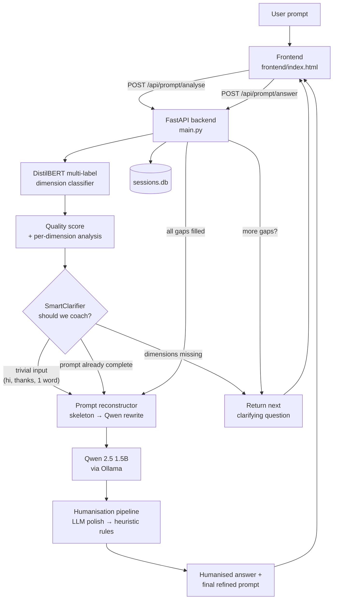

# PromptAI — Adaptive Prompt Coaching & Humanised AI Responses

> Most people talk to an LLM like they talk to a search bar. PromptAI closes that gap: it inspects a prompt, detects which of the five key **prompt dimensions** are missing, asks a handful of targeted clarifying questions, reconstructs a high-quality expert prompt, and finally answers it in a natural, human-sounding voice.

PromptAI is a full-stack, locally-runnable research prototype built around three ideas:

1. **Prompt quality can be measured** — a multi-label sentence classifier scores a prompt against five dimensions (goal, audience, format, constraints, context).
2. **Coaching beats guessing** — instead of silently expanding a vague prompt, the system asks the user only for the information that is genuinely missing.
3. **AI output should read like a person wrote it** — a two-stage humanisation pipeline rewrites the model's answer into a warmer, more conversational register.

Everything runs offline on your own machine: a DistilBERT classifier, a local Qwen 2.5 model served by Ollama, a FastAPI backend and a single-file zero-build frontend.

---

## Table of contents

- [Why this exists](#why-this-exists)
- [The five prompt dimensions](#the-five-prompt-dimensions)
- [How it works](#how-it-works)
- [Features](#features)
- [Repository structure](#repository-structure)
- [Tech stack](#tech-stack)
- [Getting started](#getting-started)
- [Configuration](#configuration)
- [API reference](#api-reference)
- [Data model](#data-model)
- [Coaching decision logic](#coaching-decision-logic)
- [The dimension classifier](#the-dimension-classifier)
- [The humanisation pipeline](#the-humanisation-pipeline)
- [Evaluation](#evaluation)
- [Frontend](#frontend)
- [Design notes & known limitations](#design-notes--known-limitations)
- [Roadmap](#roadmap)
- [Author](#author)

---

## Why this exists

A prompt like *"write an email"* is not wrong — it is **under-specified**. The model has to invent the recipient, the tone, the length and the context, and it usually invents badly. Research and practice in prompt engineering converge on the same handful of missing pieces:

| Symptom | Consequence |
| --- | --- |
| No stated **goal** | The model wanders, produces a survey instead of an answer |
| No **audience** | Vocabulary and depth are wrong (too technical / too basic) |
| No **format** | Output arrives as prose when you wanted a table or a ticket |
| No **constraints** | Wrong length, wrong tone, unwanted content |
| No **context** | Generic advice that ignores your actual situation |

PromptAI treats prompt writing as a **coaching dialogue** rather than a one-shot text expansion. The user learns *what* was missing, sees the quality score rise as they answer, and ends up with a reusable, well-formed prompt — plus the answer itself.

---

## The five prompt dimensions

The whole system is built around this fixed label space (defined in `clarification/reconstructor.py` as `ALL_DIMS`):

| Dimension | Question the system asks | Example of a satisfied prompt |
| --- | --- | --- |
| **Goal** | What is your main goal or intended output? | "Write a Python function that sorts a list" |
| **Audience** | Who is the intended audience? | "…for a 10-year-old" |
| **Format** | What format or structure do you want? | "…as a bulleted list" / "as a table" |
| **Constraints** | Any limits on length, tone or style? | "…under 200 words, formal tone" |
| **Context** | Any additional background? | "…this is for my MSc assignment" |

A prompt is scored as:

```
quality_score = (number of satisfied dimensions / 5) × 100
```

So `"explain machine learning"` scores **20%** (goal only), while a fully loaded prompt scores **100%**.

---

## How it works



The conversation is a small state machine driven by the backend:

```
analyse ──▶ [trivial]        ──▶ reconstruct (no answers) ──▶ generate ──▶ humanise
        ──▶ [complete]       ──▶ reconstruct ──▶ generate ──▶ humanise
        ──▶ [gaps: ask Q1]   ──▶ answer Q1 ──▶ ask Q2 ──▶ … ──▶ reconstruct ──▶ generate
```

Each session is persisted, so answers survive page reloads and can be re-scored later by the evaluation scripts.

> **Implementation note:** the `skip_coaching` / `direct_response` branch in `analyse` (which would answer a greeting on the spot) is currently **dead code**. `should_coach()` already returns `needs_coaching=False` for trivial input, so control leaves through the "no coaching" branch above. The behaviour is still correct — a trivial prompt simply goes to generation instead of being answered inline — but the two paths should be reconciled if you extend the clarifier.

---

## Features

**Analysis & coaching**
- Multi-label DistilBERT classifier over 5 dimensions with per-dimension calibrated thresholds
- Confidence-aware questioning: only dimensions below a confidence threshold are asked about (with `goal` always eligible)
- `SmartClarifier` gatekeeping: trivial inputs (`hi`, `thanks`, single words) skip coaching entirely; long, well-structured prompts are recognised as comprehensive and go straight to generation
- Capped at 4 questions, ordered by priority (audience → format → constraints → context)
- Live quality score, per-dimension checklist and progress in the UI

**Prompt reconstruction**
- Deterministic "skeleton" builder that packs the original prompt plus answered dimensions into a structured block
- Optional Qwen refinement pass (`temperature 0.2`) that rewrites the skeleton into one cohesive expert prompt without inventing new information
- Graceful degradation: if Ollama is unavailable, the skeleton is returned as-is

**Generation & humanisation**
- Local inference with `qwen2.5:1.5b` (temperature 0.7, 800-token cap)
- Two-stage humaniser: LLM "polish" pass, then a deterministic rule engine (contractions, plain-word substitution, transition softening, sentence splitting, closing well-wish)
- Both raw and humanised responses are returned so the difference is auditable

**Everything else**
- SQLite session store (no external database)
- CORS-wide FastAPI app with auto-generated OpenAPI docs at `/docs`
- Legacy `/analyze` and `/chat` endpoints kept for backwards compatibility
- Desktop-first, single-file frontend built with vanilla JS and no build step
- Reproducible evaluation scripts for three research questions

---

## Repository structure

```
prompt-coaching/
├── main.py                          # FastAPI app: routes, session DB, Ollama calls
├── sessions.db                      # SQLite database (session history, committed sample)
├── evaluation_results.json          # Rule-based parser evaluation output (1,581 prompts)
├── .gitattributes                   # LFS rules for *.safetensors
├── .gitignore                       # ignores prompt_classifier/, results/, dataset/, venv/
│
├── analyzer/
│   ├── parser.py                    # spaCy rule-based dimension detector (baseline)
│   ├── ml_analyzer.py               # DistilBERT training script (multi-label)
│   └── evaluate_parser.py           # Evaluates the rule-based parser vs. labelled set
│
├── clarification/
│   ├── evaluate_ml_analyzer.py      # Loads trained DistilBERT, exposes predict_* helpers
│   ├── clarification.py             # SmartClarifier + question bank
│   └── reconstructor.py             # Skeleton builder, Qwen refinement, prompt scoring
│
├── humanizer/
│   ├── __init__.py
│   └── humanizer.py                 # LLMPolisher + LinguisticHumaniser + pipeline
│
├── evaluation/
│   ├── prompts_dataset.json         # 24 held-out prompts with expected dimensions
│   ├── eval.py                      # RQ1 — classifier accuracy
│   ├── evalrq2.py                   # RQ2 — prompt completeness improvement
│   └── evalrq3.py                   # RQ3 — standard vs. coached response generation
│
└── frontend/
    └── index.html                   # Entire UI (HTML + CSS + vanilla JS, ~1k lines)
```

> **Note:** `prompt_classifier/` (the trained weights) and `results/` are git-ignored. The classifier model is therefore *not* in the repository — see [Getting started](#getting-started) for how to produce it.

---

## Tech stack

| Layer | Technology |
| --- | --- |
| API | FastAPI, Uvicorn, Pydantic |
| Classifier | PyTorch, Hugging Face Transformers, DistilBERT (`distilbert-base-uncased`), multi-label BCE with class weighting |
| Baseline parser | spaCy (`en_core_web_sm`) + hand-written keyword/heuristic rules |
| LLM | Ollama running `qwen2.5:1.5b` (chat + `/api/generate`) |
| Humaniser | Regex/rule engine + LLM polishing |
| Storage | SQLite (`sessions.db`) |
| Evaluation | scikit-learn, pandas, matplotlib |
| Frontend | Single HTML file, vanilla JS, `marked.js` (CDN) for Markdown rendering |

---

## Getting started

### Prerequisites

- **Python 3.10+** (developed on 3.11)
- **[Ollama](https://ollama.com)** installed and running locally
- ~2 GB free disk for the Qwen model, ~500 MB for model weights / caches
- (Optional) an NVIDIA GPU or Apple Silicon for faster classifier training

### 1. Clone and create an environment

```bash
git clone https://github.com/HammadBullah/prompt-coaching.git
cd prompt-coaching

python -m venv venv
source venv/bin/activate        # Windows: venv\Scripts\activate
```

### 2. Install dependencies

```bash
pip install fastapi uvicorn pydantic ollama requests
pip install torch transformers datasets scikit-learn numpy matplotlib
pip install spacy pandas
python -m spacy download en_core_web_sm   # needed only for analyzer/parser.py
```

### 3. Pull the LLM and start Ollama

```bash
ollama serve          # in a separate terminal, if not already running
ollama pull qwen2.5:1.5b
```

Check it works:

```bash
curl http://127.0.0.1:11434/api/tags
```

### 4. Provide the classifier model

The backend imports `clarification/evaluate_ml_analyzer.py`, which loads weights from `./prompt_classifier`. That directory is git-ignored, so pick one of these options:

**Option A — train it yourself.** Place the labelled dataset (`final_dataset.json`, a list of `{ "prompt": str, "labels": {goal, audience, format, constraints, context} }` records) somewhere and point `analyzer/ml_analyzer.py` at it (the path is currently hard-coded to the author's machine). Then:

```bash
python analyzer/ml_analyzer.py
# writes ./prompt_classifier/{config.json, model.safetensors, tokenizer files}
```

The script trains for 12 epochs at `lr=2e-5`, batch size 16, with `BCEWithLogitsLoss(pos_weight=...)` computed from class frequencies, then saves the model and prints Hamming loss, micro/macro F1, exact match and per-label confusion matrices.

**Option B — obtain the weights separately** from the author and drop them into `prompt_classifier/`.

> **This step is mandatory.** `main.py` imports `clarification.evaluate_ml_analyzer` at module scope, which loads the weights eagerly — so `python main.py` raises before the server binds a port if `prompt_classifier/` is missing. There is no classifier-free mode.

### 5. Run the backend

```bash
python main.py
# Uvicorn serving on http://0.0.0.0:8000
```

Interactive API docs: <http://127.0.0.1:8000/docs>

### 6. Open the frontend

`frontend/index.html` is fully static. Either open it directly in a browser, or serve it:

```bash
python -m http.server 5500 --directory frontend
# then visit http://127.0.0.1:5500
```

The frontend talks to the backend at the constant defined near the top of its `<script>` block:

```js
const API = 'http://127.0.0.1:8000';
```

Change that line if your API runs elsewhere.

---

## Configuration

| Setting | Where | Default |
| --- | --- | --- |
| LLM model | `main.py` → `OLLAMA_MODEL`, `clarification/reconstructor.py`, `humanizer/humanizer.py` | `qwen2.5:1.5b` |
| Ollama endpoint (humaniser) | `humanizer/humanizer.py` → `LLMPolisher(ollama_url=...)` | `http://127.0.0.1:11434` |
| Database path | `main.py` → `DB_PATH` | `<repo>/sessions.db` |
| Classifier path | `clarification/evaluate_ml_analyzer.py` → `model_path` | `<repo>/prompt_classifier` |
| Per-dimension thresholds | `clarification/evaluate_ml_analyzer.py` → `thresholds` | `[0.3, 0.4, 0.4, 0.2, 0.3]` |
| Max clarifying questions | `clarification/clarification.py` → `max_questions` | `4` |
| Question priority | `clarification/clarification.py` → `priority_map` | audience 1 → format 2 → constraints 3 → context 4 |
| Generation temperature | `main.py` → `generate_response` | `0.7`, `num_predict=800` |
| Reconstruction temperature | `clarification/reconstructor.py` → `_ai_refine` | `0.2` |

The per-dimension thresholds are deliberately uneven: `constraints` is the hardest label to detect (recall is the bottleneck), so it is given the most permissive threshold to encourage the classifier to flag it.

---

## API reference

Base URL: `http://127.0.0.1:8000`

| Method | Path | Purpose |
| --- | --- | --- |
| `GET` | `/` | Service banner (status, model, docs link) |
| `GET` | `/api/prompt/status` | Health check: API up? Ollama reachable? |
| `POST` | `/api/prompt/analyse` | Analyse a prompt, decide whether to coach, start a session |
| `POST` | `/api/prompt/answer` | Submit an answer for one dimension |
| `POST` | `/api/prompt/generate` | Generate + humanise the final answer for a session |
| `POST` | `/api/prompt/standard` | Baseline: answer the prompt with no coaching |
| `GET` | `/api/session/{session_id}` | Retrieve a stored session |
| `POST` | `/analyze` | *Legacy* — dimensions + questions only |
| `POST` | `/chat` | *Legacy* — optional answers → improved prompt → answer |

All request and response bodies are JSON. Request models are declared in `main.py` as Pydantic `BaseModel`s (`AnalyseRequest`, `AnswerRequest`, `GenerateRequest`, `StandardRequest`, `PromptRequest`, `ChatRequest`).

### `POST /api/prompt/analyse`

```json
{ "prompt": "help me write an email" }
```

Three shapes exist in the code, though in practice only (a) and (b) are reachable.

**a) Coaching needed**

```json
{
  "session_id": "0f2c…",
  "quality_score": 20,
  "analysis": { "goal": true, "audience": false, "format": false, "constraints": false, "context": false },
  "missing": ["audience", "format", "constraints", "context"],
  "needs_coaching": true,
  "next_question": {
    "dimension": "audience",
    "question": "Who is the intended audience for this output?",
    "example": "e.g., university students, software developers, managers, beginners",
    "priority": 2
  },
  "total_questions_available": 4,
  "message": "I've identified 4 detail(s) that could improve your prompt."
}
```

**b) Prompt already good enough** — returns `needs_coaching: false`, empty `missing`, all-true `analysis`, and a `refined_prompt` (skeleton rewritten with no answers). Note the score is reported as `quality_score if quality_score >= 80 else 100`, i.e. it is floored at 80 for presentation.

**c) Trivial input** (`hi`, `thanks`, …) — the code contains a `skip_coaching: true` + `direct_response` shape, but as noted above this branch is unreachable: trivial prompts already fall through case (b).

### `POST /api/prompt/answer`

```json
{ "session_id": "0f2c…", "dimension": "audience", "answer": "my manager" }
```

While gaps remain:

```json
{
  "status": "clarifying",
  "analysis": { "goal": true, "audience": true, "format": false, "constraints": false, "context": false },
  "quality_score": 40,
  "next_question": { "dimension": "format", "question": "What format or structure do you want for the response?", "…": "…" }
}
```

When all dimensions are covered:

```json
{
  "status": "ready",
  "analysis": { "goal": true, "audience": true, "format": true, "constraints": true, "context": true },
  "quality_score": 100,
  "refined_prompt": "…expert prompt rewritten by Qwen…",
  "message": "Reconstruction complete. Generating Expert Response..."
}
```

### `POST /api/prompt/generate`

```json
{ "session_id": "0f2c…" }
```

```json
{
  "session_id": "0f2c…",
  "raw_response": "…Qwen output…",
  "humanised_response": "…polished, conversational version…",
  "refined_prompt": "…the prompt actually sent to the model…"
}
```

Returns `503` if Ollama is unreachable, `404` for an unknown session, `500` if generation fails.

### `POST /api/prompt/standard`

Baseline for comparison — no classifier, no coaching:

```json
{ "response": "…", "ollama_running": true, "prompt_used": "write an email" }
```

### Quick smoke test

```bash
curl -s http://127.0.0.1:8000/api/prompt/status

curl -s -X POST http://127.0.0.1:8000/api/prompt/analyse \
  -H 'Content-Type: application/json' \
  -d '{"prompt":"write an email"}'
```

---

## Data model

One table, created on startup by `init_db()`:

```sql
CREATE TABLE sessions (
    session_id      TEXT PRIMARY KEY,      -- UUID4
    original_prompt TEXT,                  -- exactly what the user typed
    missing_dims    TEXT,                  -- JSON array, e.g. ["audience","format"]
    answers         TEXT DEFAULT '{}',     -- JSON object, dimension → answer
    refined_prompt  TEXT,                  -- reconstructed expert prompt
    status          TEXT DEFAULT 'clarifying',  -- 'clarifying' | 'complete'
    created_at      TIMESTAMP DEFAULT CURRENT_TIMESTAMP
);
```

The session row is the single source of truth between HTTP calls: `analyse` creates it, `answer` accumulates into `answers`, `generate` reads `refined_prompt` (falling back to `original_prompt`), and the evaluation scripts query `status='complete'` rows.

---

## Coaching decision logic

`SmartClarifier.should_coach()` evaluates, in order:

1. **Trivial?** → no coaching.
   Single word, fewer than three words with no intent verb (`write`, `explain`, `make`, …), or an explicit greeting/acknowledgement (`hi`, `hey`, `thanks`, `ok`, `lol`, `what's up`, …), or a string of only punctuation/digits.

2. **Comprehensive?** → no coaching.
   At least 8 words and 4 of 5 keyword groups present (goal / audience / format / constraints / context), *or* at least 20 words with 2 groups present. This rewards naturally verbose prompts without punishing brevity too hard.

3. **High external quality score?** → no coaching (if a score ≥ 80 is supplied).

4. **Otherwise, ask.**
   Missing dimensions are filtered by confidence (`min_confidence_ask = 0.5`, with `goal` always eligible), sorted by priority, truncated to `max_questions = 4`, and mapped onto the question bank in `get_clarification_questions()`.

Note that quality scoring is implemented in more than one place, all using the same `present / 5 × 100` formula: `score_prompt()` in `clarification/reconstructor.py` (takes the classifier's missing-dimension list), `_calculate_quality_score()` in `SmartClarifier` (takes a boolean analysis dict), and `score_prompt()` in `analyzer/parser.py` (takes a raw prompt — the rule-based baseline).

---

## The dimension classifier

**Task:** multi-label classification — five independent binary decisions per prompt, not a single class.

| Item | Value |
| --- | --- |
| Backbone | `distilbert-base-uncased` |
| Head | `DistilBertForSequenceClassification`, `num_labels=5`, `problem_type="multi_label_classification"` |
| Loss | `BCEWithLogitsLoss` with `pos_weight` = `negatives / positives`, clamped at 50 |
| Epochs | 12 |
| Learning rate | 2e-5 |
| Batch size | 16 (train and eval) |
| Weight decay | 0.01 |
| Max token length | 128 (training) / 512 (inference) |
| Train / test split | 80 / 20, `seed=42` |
| Device | Apple MPS if available, else CPU |

**Inference thresholds** (`clarification/evaluate_ml_analyzer.py`):

| Dimension | Threshold | Rationale |
| --- | --- | --- |
| goal | 0.30 | Slightly permissive; goal is almost always present |
| audience | 0.40 | |
| format | 0.40 | |
| constraints | 0.20 | Lowest — hard to detect lexically, better to over-ask |
| context | 0.30 | |

`predict_missing_dimensions(text)` returns the dimensions whose sigmoid probability falls **below** threshold. `predict_with_confidence(text)` returns booleans plus the raw probabilities (`goal_confidence`, …), which the clarifier uses to decide whether a question is worth asking.

Class weighting matters here because the label distribution is heavily skewed: in the labelled set the `goal` dimension is present in the overwhelming majority of prompts (hence only 24 true negatives in the evaluation below), while `format` and `constraints` are comparatively rare.

**Baseline:** `analyzer/parser.py` implements the same five checks with keyword lists plus optional spaCy POS tagging (a VERB in a prompt of 5+ words counts as a goal signal). It exists for comparison, and it is what produced `evaluation_results.json`.

---

## The humanisation pipeline

Humanisation runs **after** generation, in two stages (`humanizer/humanizer.py`):

```
Qwen answer ──▶ Stage 1: LLM polish ──▶ Stage 2: rule-based rewrite ──▶ final_output
```

**Stage 1 — `LLMPolisher`.** A second Qwen call instructs the model to keep the meaning while sounding warm and conversational: use contractions, prefer simple words, drop robotic/academic phrasing. A `polish_with_context()` variant accepts `academic` / `casual` / `professional` hints (the pipeline itself always uses the plain `polish()`). Any failure (timeout, Ollama down) returns the original text unchanged.

**Stage 2 — `LinguisticHumaniser.apply_heuristic_rules()`.** A deterministic pass over five rule maps, applied in order:

| Rule set | Examples |
| --- | --- |
| `HEDGING_RULES` | "The first step involves" → "I usually start by" |
| `PERSONALIZATION_MAP` | "it is" → "it's", "do not" → "don't", "cannot" → "can't" |
| `PHRASAL_VERB_MAP` | "utilise" → "use", "commence" → "start", "purchase" → "buy" |
| `TRANSITION_MAP` | "In conclusion" → "So", "Furthermore" → "Also", "Therefore" → "That's why" |
| `EXPANDED_HUMAN_MAP` | "pivotal" → "really important", "Due to the fact that" → "Because", "In order to" → "to" |

Then: sentences over 25 words containing ", and " are split (varying sentence length is a strong human signal), and a closing line is appended from `WELL_WISHING` ("Hope this helps you out!", …) unless one is already present.

`HumanizationPipeline.humanize()` returns the intermediate stages too (`stage_1_llm_polished`, `stage_2_rule_humanised`) plus length statistics, so the effect of each stage can be inspected. Shortcuts `humanize_quick()` (rules only) and `humanize_llm_only()` (polish only) support ablations.

> **Caveat:** the rule engine is deliberately simple and regex-driven — it is a research demonstrator of register shift, not a detector-evasion tool.

---

## Evaluation

Three scripts map onto three research questions. All write under `results/` (git-ignored).

### RQ1 — How accurately can missing dimensions be detected?

```bash
python evaluation/eval.py
```

Runs `predict_missing_dimensions()` over `evaluation/prompts_dataset.json` — 24 held-out prompts spanning single-dimension and heavily-specified cases — and writes a scikit-learn classification report to `results/rq1_accuracy_results.txt`.

A larger, 1,581-prompt evaluation of the rule-based baseline lives in `evaluation_results.json` (generated by `analyzer/evaluate_parser.py`):

| Dimension | Accuracy | Precision | Recall | F1 | TP | TN | FP | FN |
| --- | --- | --- | --- | --- | --- | --- | --- | --- |
| goal | 91.1% | 93.9% | 96.7% | 95.3% | 1416 | 24 | 92 | 49 |
| audience | 71.0% | 53.0% | 88.2% | 66.2% | 448 | 675 | 398 | 60 |
| format | 72.3% | 83.6% | 60.4% | 70.2% | 515 | 628 | 101 | 337 |
| constraints | 82.9% | 83.9% | 62.7% | 71.8% | 343 | 968 | 66 | 204 |
| context | 74.8% | 66.7% | 83.8% | 74.3% | 576 | 607 | 287 | 111 |
| **Overall accuracy** | **78.4%** | | | | | | | |

Total: 7,905 predictions over 1,581 prompts, 1,705 misclassifications. The shape of the errors is informative — the lexical baseline over-flags `audience` (any "for" looks like an audience) and under-flags `format` and `constraints` (real constraints are often implicit), which is precisely why the DistilBERT classifier and the confidence-based questioning exist.

### RQ2 — How much does coaching improve prompt completeness?

```bash
python evaluation/evalrq2.py
```

Reads every `status='complete'` session from `sessions.db`, recomputes the original and final dimension counts, and writes `results/rq2_completeness_results.csv` with per-session `Original_Score`, `Final_Score` and `Improvement_Delta`, plus the mean improvement. Because the score is `dims / 5`, the ceiling for improvement depends on the original prompt's starting point.

### RQ3 — Standard vs. coached responses

```bash
python evaluation/evalrq3.py
```

For 10 fixed prompts ("Write a report about AI", "Explain machine learning", "Plan a trip to Japan", …) the script:

1. generates a **standard** answer from the raw prompt,
2. predicts missing dimensions,
3. fills the gaps automatically from a fixed `COMMON_ANSWERS` profile,
4. reconstructs the prompt and generates a **coached** answer,
5. humanises the coached answer,
6. appends everything to `results/rq3_raw_data.json` (rewritten after every sample, so partial runs are safe).

This produces a side-by-side corpus suitable for human or LLM-judge comparison of relevance, specificity and readability.

---

## Frontend

`frontend/index.html` is a single ~1,000-line file: all CSS inline, all JS vanilla, no bundler, no `node_modules`. It renders a three-panel layout inside a full-height shell:

- **Header** — the `PromptAI` wordmark (Instrument Serif), a **Coached / Standard** mode toggle, and a live status pill (`Ready` / `Ollama offline` / `API offline`) driven by polling `/api/prompt/status`.
- **Left sidebar (220 px)** — the **Quality Score** (large numeral, percentage sub-label, progress bar) and the **Dimensions** checklist, whose dots and ✓/✗ tags flip as dimensions get answered; a **Model** block pinned to the bottom names the DistilBERT classifier and Qwen 2.5 via Ollama.
- **Centre** — the coaching chat. Prompts, clarifying questions and answers appear as bubbles (questions are a distinct message type), with a typing indicator while the backend works. Suggestion chips ("help me write something", "explain machine learning", "write an email", "make a workout plan") bootstrap the first turn, and an Enter-to-send textarea with auto-grow sits at the bottom.
- **Right panel** — **Humanised Response** (Markdown-rendered via `marked.js`) above **Refined Prompt** (plain text), plus a `↺ New session` reset button.

Client state is just `sessionId`, `currentDim` and `mode`; the backend holds everything else. `reset()` clears the session and restores the empty state.

---

## Design notes & known limitations

This is a **research prototype**, and the code reflects that honestly:

- **Hard-coded absolute paths.** `analyzer/ml_analyzer.py`, `analyzer/evaluate_parser.py`, `evaluation/evalrq2.py` and `evaluation/evalrq3.py` still reference the author's local dataset/DB locations (e.g. `/Users/hammadsafi/Downloads/prompt coaching/…`). Update them before running; `main.py`, `reconstructor.py` and the classifier loader already resolve paths relative to the repo.
- **The trained classifier is not committed.** `prompt_classifier/` is git-ignored, so `main.py` will fail on import until the weights exist or you train them.
- **Synchronous Ollama calls inside async routes.** `ollama.chat()` and `requests.post()` block the event loop; fine for single-user local use, not for concurrency.
- **Two generations of API.** `/analyze` and `/chat` are legacy routes kept for compatibility; the `/api/prompt/*` family is the supported surface.
- **No authentication or rate limiting.** CORS is wide open (`allow_origins=["*"]`) and the DB is unauthenticated — local-only by design.
- **Question bank is static.** Clarifying questions come from a fixed dictionary rather than being generated, which keeps behaviour reproducible but limits coverage of unusual dimensions.
- **Severity of rule-based humanisation.** Substitution maps are order-sensitive and applied case-insensitively, so a replacement can fire in unintended places (e.g. "Such as" → "like" inside a sentence where it reads oddly). The closing well-wish is appended to *every* response, including ones that already end warmly.
- **Single-user assumptions.** SQLite writes are unsynchronised; a few code paths call `db_get_session` twice per request.

### Dependency reference

No `requirements.txt` is committed yet. The full set of third-party imports across the repository is:

```
fastapi  uvicorn  pydantic  ollama  requests
torch  transformers  datasets  scikit-learn  numpy  matplotlib
spacy  pandas
```

---

## Roadmap

- [ ] Ship a config file (`config.yaml` / `.env`) and remove all hard-coded paths
- [ ] Commit or release the trained classifier weights (with an LFS-friendly download script)
- [ ] Replace blocking Ollama calls with `asyncio`/`httpx` and add a request queue
- [ ] Make clarifying questions LLM-generated, using the static bank as a fallback
- [ ] Add a side-by-side **standard vs. coached** comparison view in the UI
- [ ] Deploy the frontend as a static build with a configurable API base URL
- [ ] Add unit tests for the clarifier decision rules and the reconstructor skeleton
- [ ] Expand the evaluation set beyond 24 prompts and publish per-dimension ablations

---

## Author

**Hammad Safi** — MSc project, University of Hertfordshire.

Built as a study of adaptive prompt coaching: measuring prompt quality, asking better questions, and making model output sound human.

No licence file is currently included in this repository; add one before distributing or reusing the code.
